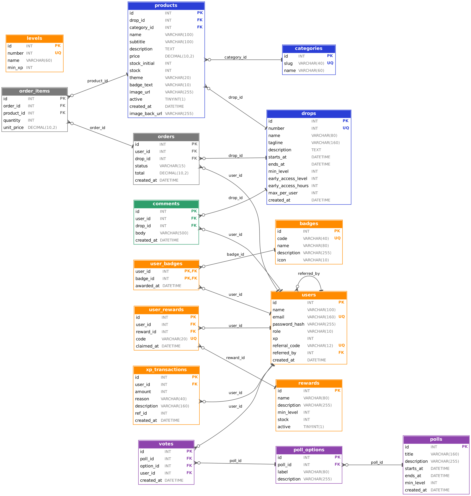

# DripLab — plataforma de streetwear digital-first

Projeto Integrador de Desenvolvimento de Sistemas (SENAI): **front-end + API REST + banco de dados MySQL**, totalmente integrados.

🌐 **Site publicado:** (https://driplab-y54i.onrender.com/#home)
📂 **Repositório:** (https://github.com/maazpx/driplab)

| Conta de teste | E-mail | Senha |
|---|---|---|
| Cliente | `demo@driplab.com` | `Demo@123` |
| Administrador | `admin@driplab.com` | `Admin@123` |

## Descrição
A **DripLab** é uma loja de streetwear com lançamentos limitados (**drops**), que mistura a cultura de rua com **gamificação**: quem compra, vota e participa da comunidade ganha XP, sobe de nível, conquista badges e libera recompensas e acesso antecipado. O usuário não é só cliente: ele faz parte do laboratório.

## Objetivo do sistema
Permitir que a marca venda peças em quantidade limitada com **contagem regressiva real**, controle de estoque confiável e limite por pessoa, e ao mesmo tempo engaje a comunidade com votação das próximas coleções, comentários e um sistema de progressão (XP, níveis, badges e recompensas).

## Funcionalidades
- **Login e cadastro** com senha criptografada (scrypt), sessão por token JWT e código de indicação.
- **Drop da vez** com contagem regressiva vinda do servidor, estoque somado e acesso por nível/antecipado.
- **Loja** com filtro por categoria, busca, detalhe do produto e **fotos de frente e verso**.
- **Carrinho e compra** (pagamento simulado): baixa de estoque, limite de peças por pessoa e ganho de XP.
- **Gamificação**: XP, 10 níveis, badges automáticos, ranking e recompensas por nível.
- **Votação** da próxima coleção (1 voto por pessoa) e **mural de comentários**.
- **Minha conta**: pedidos (com cancelamento que devolve estoque e XP), badges, indicação e recompensas.
- **Painel/API para administradores**: CRUD de produtos, drops, votações, badges, recompensas e usuários.
- Layout **responsivo** (desktop, tablet e celular).

## Tecnologias utilizadas
| Camada | Tecnologia |
|---|---|
| Front-end | HTML, CSS e JavaScript puro |
| Back-end | Node.js (módulo `http` nativo, sem framework) + `mysql2` |
| Banco de dados | MySQL 8 (migrations SQL versionadas) |
| Documentação da API | OpenAPI/Swagger em `/api/docs` |
| Testes | `node:test` (49 testes automatizados) |
| Versionamento | Git / GitHub |

## Modelagem do banco de dados
16 tabelas e 2 views, normalizadas até a 3FN. Arquivos na pasta [`docs/`](docs):

| Item | Arquivo |
|---|---|
| Modelagem conceitual | [`docs/MODELAGEM_CONCEITUAL.md`](docs/MODELAGEM_CONCEITUAL.md) |
| Modelagem lógica | [`docs/MODELAGEM_LOGICA.md`](docs/MODELAGEM_LOGICA.md) |
| Modelo físico | [`adicionais/01_criar_banco.sql`](adicionais/01_criar_banco.sql) |
| DER (diagrama) | [`docs/DER-DripLab.png`](docs/DER-DripLab.png) · [`.svg`](docs/DER-DripLab.svg) |
| Documento completo + regras de negócio | [`docs/MODELAGEM.md`](docs/MODELAGEM.md) |



**Áreas:** Loja (`categories`, `drops`, `products`, `orders`, `order_items`) · Comunidade (`polls`, `poll_options`, `votes`, `comments`) · Gamificação (`levels`, `badges`, `user_badges`, `xp_transactions`, `rewards`, `user_rewards`) · Núcleo (`users`).

**Destaques de integridade:** FK composta e UQ em `votes` (1 voto por pessoa na votação certa), `order_items.unit_price` com o preço histórico, `CHECK` (estoque ≥ 0, preço ≥ 0, datas válidas…) e controle de estoque com `UPDATE … WHERE stock >= ?` em transação com `FOR UPDATE`.

## Como instalar e rodar
Resumo (passo a passo completo em [`adicionais/INSTALACAO.md`](adicionais/INSTALACAO.md)):
```bash
cd backend
npm install
copy .env.example .env      # Linux/Mac: cp .env.example .env  → edite DB_PASSWORD e JWT_SECRET
npm run db:setup            # cria banco, tabelas e dados de exemplo
npm start                   # http://localhost:3000
```
Requisitos: Node.js 20+ e MySQL 8. Abra sempre por `http://localhost:3000` (não pelo duplo clique no `index.html`).

## Estrutura do repositório
```
driplab/
├── backend/            # API Node.js (src/, scripts/, test/)
├── frontend/           # index.html, style.css, script.js, img/
├── database/
│   ├── migrations/     # 001_init.sql, 002_product_back_image.sql
│   └── extras/         # trigger e procedure opcionais
├── docs/               # modelagem conceitual, lógica, DER, regras de negócio
└── adicionais/         # scripts SQL (criar e inserir dados) + INSTALACAO.md
```

## API (resumo — detalhes no Swagger em `/api/docs`)
Autenticação por `Authorization: Bearer <token>`.

| Recurso | Rotas |
|---|---|
| Auth | `POST /api/auth/register`, `POST /api/auth/login`, `GET /api/auth/me` |
| Usuários | `GET/POST /api/users`, `GET/PUT/DELETE /api/users/:id`, `GET /api/users/ranking` |
| Categorias / Produtos | `/api/categories`, `/api/products` (CRUD) |
| Drops | `/api/drops`, `GET /api/drops/current` |
| Pedidos | `POST/GET /api/orders`, `POST /api/orders/:id/cancel` |
| Votações | `/api/polls`, `POST /api/polls/:id/vote` |
| Comentários | `GET/POST /api/drops/:id/comments`, `PUT/DELETE /api/comments/:id` |
| Gamificação | `/api/gamification/*`, `/api/badges`, `/api/rewards`, `POST /api/rewards/:id/claim` |

## Segurança
Consultas parametrizadas, senhas com scrypt + salt, JWT com expiração, validação de entrada, autorização por perfil/dono, limite de tentativas de login, cabeçalhos de segurança + CSP e front sem `innerHTML`.

## Autoria
Marcela Rezende — SENAI.
