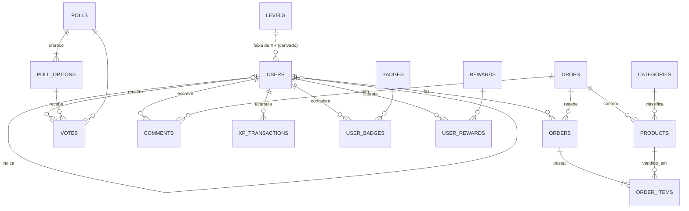

# Modelagem conceitual — DripLab

Entidades, atributos principais e relacionamentos do sistema. O diagrama completo (com tipos e chaves) está em [DER-DripLab.png](DER-DripLab.png).

| Entidade | O que representa |
|---|---|
| **Usuário** | Pessoa cadastrada (cliente ou administrador). Acumula XP. Pode indicar outros usuários. |
| **Nível** | Faixas de XP (ROOKIE … DRIPLORD). Define acesso exclusivo e recompensas. |
| **Drop** | Lançamento limitado, com janela de tempo, nível mínimo, acesso antecipado e limite por pessoa. |
| **Categoria** | Hoodies, T-shirts, acessórios… |
| **Produto** | Peça vendida dentro de **um** drop, com estoque próprio. |
| **Pedido / Item do pedido** | Compra de um usuário num drop (pagamento simulado). |
| **Votação / Opção / Voto** | Comunidade escolhe a próxima coleção. 1 voto por usuário por votação. |
| **Comentário** | Mural da comunidade em cada drop. |
| **Badge / Badge do usuário** | Conquistas. |
| **Transação de XP** | Histórico (ledger) de todos os pontos ganhos/perdidos. |
| **Recompensa / Recompensa resgatada** | Benefícios liberados por nível. |

Relacionamentos principais: Drop 1—N Produto · Categoria 1—N Produto · Usuário 1—N Pedido · Pedido 1—N Item ·
Produto 1—N Item · Votação 1—N Opção · Opção 1—N Voto · Usuário 1—N Voto · Usuário N—M Badge · Usuário N—M Recompensa ·
Usuário 1—N Comentário · Drop 1—N Comentário · Usuário 1—N Usuário (indicação).

